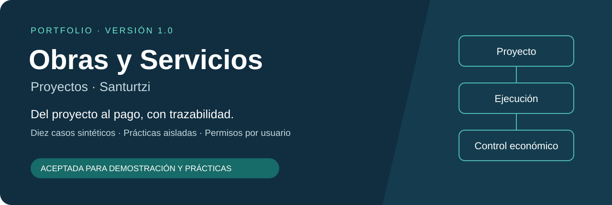
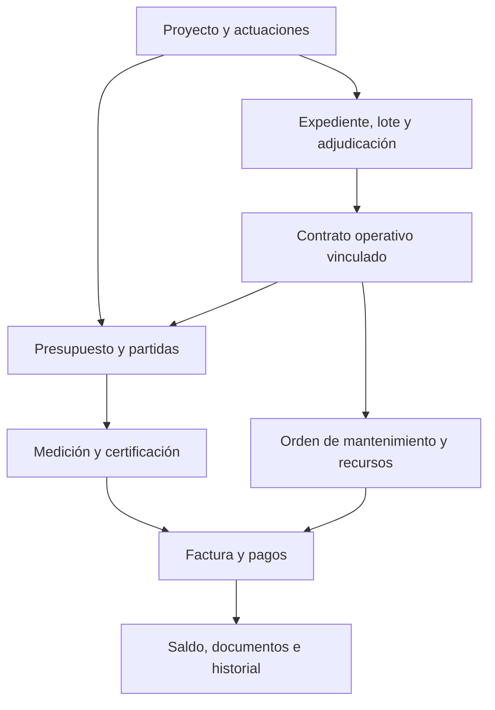

# Obras y Servicios · Santurtzi



**Aplicación web para conectar proyectos, contratación, ejecución y pagos en un mismo recorrido.** Versión **1.0 terminada y aceptada el 25/10/2026** para demostración y prácticas con datos sintéticos.

Proyecto de portfolio de [JsphLynx](https://github.com/JsphLynx), centrado en las necesidades de un departamento de Obras y Servicios. Es un piloto independiente: su aceptación corresponde al usuario promotor del proyecto; no acredita implantación ni aprobación del Ayuntamiento.

**React · TypeScript · PostgreSQL / Neon · Vinext / Vite · Cloudflare Workers / R2**

[Guía de uso (PDF)](docs/manuales/01_Guia_de_uso_Obras_Servicios_v1_0.pdf) · [Recorridos y alcance (PDF)](docs/manuales/02_Recorridos_y_alcance_Obras_Servicios_v1_0.pdf) · [Modelo relacional](docs/assets/modelo-relacional.svg) · [Validación](docs/validacion.md)

## El problema que aborda

Una obra o servicio distribuye su información entre proyectos, ubicaciones, contratos, partidas, certificaciones, facturas y documentos. Consultar cada registro por separado dificulta explicar qué se ejecutó, qué se facturó, cuánto se pagó y qué queda pendiente.

El piloto relaciona estos datos, conserva el historial de cambios y ofrece un entorno de prácticas separado de los ejemplos de referencia. Permite aprender el recorrido completo sin utilizar datos municipales reales.

## Qué puedes explorar

| Área | Funcionalidad de la versión 1.0 |
|---|---|
| Proyectos y territorio | Proyectos, inmuebles, emplazamientos, actuaciones, gastos y repartos. |
| Contratación y ejecución | Contrato operativo desde una adjudicación existente, contratos compartidos, revisiones de presupuesto, partidas, mediciones y certificaciones. |
| Control económico | Facturas, pagos parciales, límites de pago, rectificativas y devoluciones. |
| Mantenimiento | Activos, planes preventivos, incidencias, órdenes y recursos; cierre y reapertura con historial. |
| Seguimiento | Hitos, previsiones de coste, recepciones, subsanaciones y garantías. |
| Documentos y acceso | Subida y descarga de archivos, referencias, consultas CSV y perfiles por usuario. |

La adjudicación administrativa completa no dispone de un formulario de tramitación en esta versión. El recorrido operativo comienza con adjudicaciones sintéticas ya preparadas. La brigada municipal tiene un recorrido propio de órdenes y costes internos, sin facturas ni pagos a sí misma.

## Un recorrido representativo



Esquema funcional simplificado; las claves y cardinalidades exactas están en el [modelo relacional completo](docs/modelo-datos.md).

## Decisiones técnicas que merece la pena revisar

- **Trazabilidad contractual:** enlace mediante clave foránea entre `operativa_stz.stz_contracts.id_adjudicacion` y `contratacion.adjudicaciones.id_adjudicacion`; contratos compartidos sin duplicar su importe.
- **Integridad económica:** importes en céntimos, cantidades en milésimas, consultas parametrizadas y transacciones para las operaciones relacionadas.
- **Separación de entornos:** ejemplos protegidos y prácticas compartidas en otra rama de PostgreSQL, con verificación del identificador de entorno y del rol de conexión.
- **Autorización en el servidor:** el rol de negocio se consulta en PostgreSQL a partir de la identidad autenticada por Sites; ocultar botones no es el único control.
- **Documentación comprobable:** manuales, diez casos de referencia, catálogo de tablas y relaciones, pruebas de servidor y resumen de ensayos con sesiones reales.

Puntos de entrada para revisar código: [reglas de negocio](lib/stz/service.ts), [acceso y roles](lib/stz/access.ts), [transacciones y números](lib/stz/db.ts), [formularios](lib/stz/forms.ts) y [rutas de la API](app/api).

## Estado de la versión 1.0

| Criterio de aceptación | Resultado registrado |
|---|---|
| Diez ejemplos protegidos | 365 comprobaciones de coherencia; comparación final de 475 filas en 37 tablas sin ausencias ni modificaciones. |
| Prácticas aisladas | Ensayos persistidos en una rama separada; originales conservados. |
| Manuales | Guía y diez fichas revisadas, más dos manuales PDF de aprendizaje. |
| Permisos por usuario | Segunda cuenta real comprobada como pendiente, lector, editor y bloqueado. |
| Formularios y recorridos | Ejecución, mantenimiento, facturación, pagos, rectificaciones, archivos y CSV verificados dentro del alcance acordado. |

Estos resultados corresponden a la validación del piloto original entre el 21 y el 25/10/2026. No son una nueva ejecución de esas pruebas en GitHub. [Evidencia, método y límites →](docs/validacion.md)

## Documentación

- [Arquitectura y decisiones](docs/arquitectura.md)
- [Modelo de datos: 104 tablas distintas y 159 claves foráneas](docs/modelo-datos.md)
- [Diez ejemplos y sus manuales](docs/manuales/diez-ejemplos.md)
- [Alcance, aceptación y evolución](docs/alcance.md)
- [Preparación local y configuración](docs/desarrollo.md)
- [Pruebas y resultados de la edición pública](docs/pruebas.md)
- [Seguridad y límites del despliegue](SECURITY.md)

## Revisar y ejecutar el código

```bash
git clone https://github.com/JsphLynx/Obras-Servicios-Stz-Proyectos.git
cd Obras-Servicios-Stz-Proyectos
# Node.js >= 22.13 y pnpm 11.25.0
pnpm install --frozen-lockfile
cp .openai/hosting.example.json .openai/hosting.json
pnpm test:unit
pnpm typecheck
pnpm build
```

La compilación y las pruebas unitarias no necesitan credenciales. Para utilizar los formularios se requieren bases de datos preparadas, almacenamiento y una identidad de confianza: consulta la [guía de desarrollo](docs/desarrollo.md). Las migraciones publicadas son incrementales y **no reconstruyen por sí solas todo el esquema de la versión 1.0**. Este repositorio permite revisar el código; no incluye una base de datos privada ni un despliegue autónomo de un clic.

El acceso a la demostración funcional se facilita bajo autorización del responsable del proyecto. Los PDF y el modelo relacional pueden consultarse públicamente desde este repositorio.

## Siguiente etapa

La implantación con datos reales requiere un entorno real configurado, permisos municipales acordados, recuperación comprobada, responsables de mantenimiento y aceptación del Ayuntamiento. El despliegue en Azure y la interrelación con Microsoft 365 / Copilot son objetivos posteriores; no se presentan como capacidades implementadas.

## Autoría y procedencia

Portfolio de **JsphLynx**: definición del objetivo, alcance, revisión de los casos y aceptación de la versión. Desarrollo y documentación realizados con asistencia de IA y herramientas de Sites, Neon y automatización de navegador. El repositorio conserva los avisos de terceros incluidos en el código base. Consulta [procedencia y cambios de publicación](docs/procedencia.md).

**English overview:** A municipal works and services learning pilot connecting projects, contracts, execution, invoices and payments. Version 1.0 was accepted for synthetic demonstrations and shared practice. The repository contains reviewable TypeScript source, Spanish user manuals, the relational model and a scoped validation summary. It is not an operational municipal deployment.
