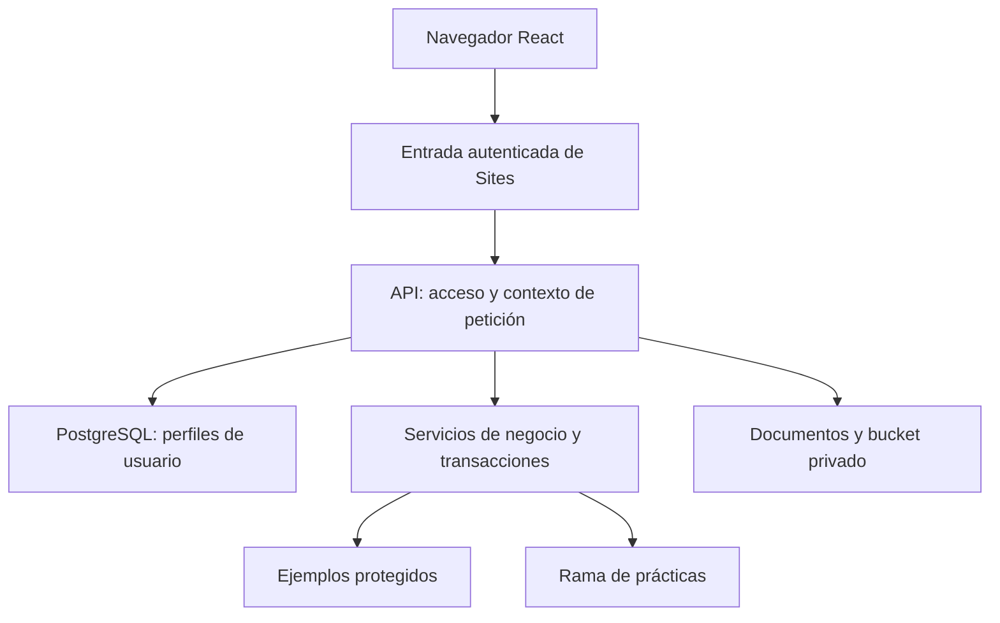

# Arquitectura

## Componentes y responsabilidades

| Capa | Implementación | Responsabilidad |
|---|---|---|
| Interfaz | React 19, TypeScript, Tailwind y componentes de UI | Navegación, selección de entorno, formularios y visualización. |
| Servidor web | Rutas con API de Next, compiladas con Vinext/Vite y ejecutadas en Workers | Autorización, validación y coordinación de operaciones. |
| Identidad | Entrada autenticada de Sites | Entrega al servidor la identidad de la sesión. |
| Roles | Tablas de acceso en PostgreSQL | ADMIN, EDITOR, LECTOR, PENDIENTE y BLOQUEADO. |
| Datos | Neon PostgreSQL; PostGIS presente en el modelo | Relaciones, transacciones, controles, ejemplos y prácticas. |
| Archivos | Bucket privado R2 y referencias en PostgreSQL | Contenido de adjuntos y descarga autorizada. |

La identidad de Sites y el rol funcional de la aplicación son dos niveles distintos. Un editor de prácticas no obtiene por ello permiso para editar el código del Site.

## Escrituras y concurrencia

`lib/stz/context.ts` conserva el contexto por petición. `access.ts` resuelve identidad, estado y rol. `db.ts` comprueba el entorno, utiliza parámetros SQL, exige un actor coherente con la sesión y agrupa escrituras relacionadas en transacciones. Un bloqueo transaccional serializa las mutaciones de negocio; una escritura condicional obsoleta provoca el rechazo de la operación completa.

`service.ts` reúne reglas de cantidades, presupuestos, estados, contratos, facturación, pagos y mantenimiento. Hay controles tanto en servidor como en PostgreSQL. Los botones de la interfaz sirven de orientación y no sustituyen esas comprobaciones.

## Separación y límites

Los ejemplos son de consulta. Las prácticas admiten escritura para ADMIN y EDITOR y son compartidas entre usuarios autorizados: no equivalen a un espacio privado por persona ni a un entorno que se reinicie automáticamente. La configuración de identidades puede utilizar otra conexión de PostgreSQL; las pruebas automatizadas requieren un destino QA separado.

El modelo contempla PostGIS, pero las geometrías oficiales están pendientes. No se acredita integración operativa con QGIS. No hay conexión implementada con Azure, Microsoft 365 ni Copilot.

La edición pública parametriza los identificadores de rama y elimina una excepción de origen específica de la publicación privada. Esas diferencias se detallan en [procedencia](procedencia.md).
