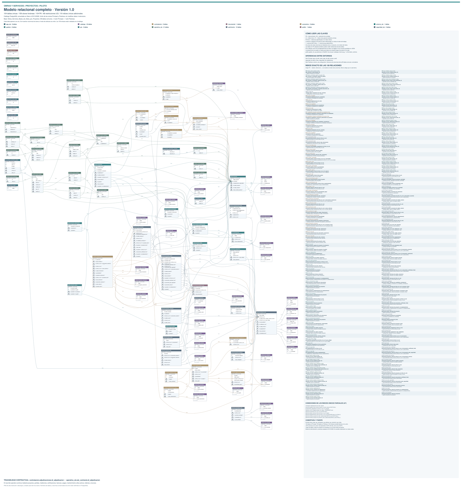

# Modelo relacional de la versión 1.0

[Ver el diagrama completo en SVG](assets/modelo-relacional.svg) · [Vista PNG](assets/modelo-relacional-preview.png) · [Catálogo estructurado](database/catalogo-v1.0.json)

Corte de introspección: **25/10/2026**. El SVG conserva el detalle para ampliar y un directorio de las claves foráneas. La imagen PNG es una vista reducida de navegación, no sustituye al SVG para leer cada clave.

| Magnitud | Valor |
|---|---:|
| Esquemas presentes en la unión de entornos | 12 |
| Tablas del entorno de ejemplos | 103 |
| Tablas del entorno de prácticas | 100 |
| Tablas comunes | 99 |
| Tablas distintas en la unión | 104 |
| Columnas en esa unión | 1.070 |
| Claves primarias | 104 |
| Claves foráneas validadas | 159 |
| Restricciones únicas | 66 |
| Índices únicos adicionales | 19 |

**104 no significa que una única base tenga 104 tablas.** El diagrama une los dos entornos y señala sus diferencias. Muestra las columnas que intervienen en claves; el catálogo incluye el resto de atributos. Las vistas no se cuentan como tablas.

## Dominios

| Esquema | Tablas | Contenido |
|---|---:|---|
| `catalogo` | 35 | Catálogos y tipologías. |
| `operativa_stz` | 21 | Ejecución, mantenimiento y seguimiento económico operativo. |
| `patrimonio` | 12 | Entidades patrimoniales. |
| `app_stz` | 9 | Soporte de aplicación, acceso y ejemplos. |
| `gestion` | 8 | Proyectos, actuaciones y organización de la gestión. |
| `contratacion` | 6 | Expedientes, lotes, adjudicaciones y contratistas. |
| `economico` | 6 | Gestión económica compartida. |
| `gis` | 2 | Soporte territorial. |
| `seguridad_stz` | 2 | Protección y validaciones. |
| `documental` | 1 | Documentación compartida. |
| `entorno_stz` | 1 | Configuración específica de prácticas. |
| `public` | 1 | `spatial_ref_sys` de PostGIS. |

Solo en ejemplos: `app_stz.web_access_audit`, `app_stz.web_users`, `seguridad_stz.demo_filas` y `seguridad_stz.validaciones`. Solo en prácticas: `entorno_stz.configuracion`.

## Conexión contractual

`operativa_stz.stz_contracts.id_adjudicacion` referencia mediante FK a `contratacion.adjudicaciones.id_adjudicacion`. La columna tiene restricción de unicidad y admite nulos a nivel de esquema; el alta desde la aplicación exige una adjudicación existente. No debe describirse la FK como obligatoria para cualquier registro posible del esquema.

Los vínculos de proyecto permiten compartir un contrato. La brigada interna se explica mediante órdenes y recursos, sin forzar una adjudicación externa ficticia.

El JSON contiene metadatos estructurales, no filas de negocio ni credenciales. No es un volcado restaurable ni incluye las definiciones completas de funciones, vistas y protecciones. Las migraciones de `migrations/` son históricas e incrementales: deben contrastarse con un esquema completo autorizado antes de provisionar una nueva base.
